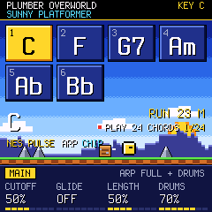

# PIXEL RUN

A firmware for the M-VAVE FM-1 by **swtdr34mz**: the chiptune sibling of
[CHORD RUN](https://github.com/swtdr34mz-afk/CHORD_RUN), based on [Blop / OSR-1](https://github.com/OSR-Experiment/OSR-1)
by Obsimo (OSR Records). Built on [fm1-base](https://github.com/charlesvestal/fm1-base) and
[felucca-bsp](https://github.com/hugelton/felucca-bsp).

Play the chords of a video game tune with one finger and a melody over them, with chip sounds and chip drums, build
your own drum grooves, loop 8 bars of chords to jam over, while a little pixel runner runs as long as you play.

**Play it in the browser:** https://swtdr34mz-afk.github.io/PIXEL_RUN/emu/ (the same firmware, built for the browser).

 

## What it does

- **Sets:** 20 chord progressions in the style of famous video game tunes (platformers, racing, castles, battles,
  underwater levels ...), under names of their own. A set's chords sit on the **black keys** (left to right). Each set
  brings its own sounds, tempo, bass, drums and, where it fits, the chip arpeggio.
- **Melody:** the **white keys** play the set's scale, fitted to the chord that plays (as in CHORD RUN). ASSIST (MELODY 2)
  lights up the chord's notes, or GUIDE: a made-up melody that lights up key by key.
- **Sounds:** 17 chip sounds: pulse waves (12.5, 25 and 50 %), a sweeping PWM, a handheld's 4-bit wave channel, the 8-bit
  consoles' stepped triangle, a home computer's stepped saw through its filter, a laser lead, a coin blip, a crushed pad,
  and the 16-bit consoles' FM (brass, bell, e-piano, strings). The bass has the chip TRIANGLE and PULSE too.
- **Chip arpeggio:** ARP's rates FAST and CHIP play a chord as one fast arpeggio (30 or 60 notes a second), the classic
  way 8-bit music plays chords.
- **Drums:** five kits (8-BIT, HANDHELD, 16-BIT, ROBOT, ARCADE) whose noise comes from a shift register, as the old sound
  chips made it, with a stepped triangle kick. 20 grooves: platformer, overworld, shuffle, castle, boss fight, racing,
  dungeon, shooter, puzzle, title, victory, underwater, space, chip house, chip trap, chip breaks, chip funk, chip hip hop,
  gallop, credits.
- **DRUM STUDIO:** build a groove of your own: 16 steps on 4 tracks (kick, snare, hats, perc), a kit, a swing, and keep it
  in one of 20 user slots (kept in the flash, in the backup too).
- **FX:** a bitcrusher (fewer bits, a lower sample rate), delay, chorus, reverb, and the sidechain (GROOVE).
- **Loop:** press REC, play up to 8 bars of chords (REC again closes it at its bar), and they play round while you play the
  melody on top, or build drums in the studio.
- **The run:** a pixel runner runs while you play. The metres add up, the best run is kept, ten characters unlock, and
  there is always a mission (play 24 chords, run 120 m at once, save a groove in the studio ...) that gives extra metres.

## Controls

| Control | What it does |
| --- | --- |
| Black keys | The set's chords. With a rhythm the chord keeps playing (the same key again stops it); without one (HELD) it plays while you hold the key. The black keys right of the chords play the melody too |
| White keys | The melody |
| SELECT | Set (its own sounds, tempo, arpeggio and drums come with it) |
| ALGORITHM | Chord rhythm: HELD, FULL (held, with the drums: the first start's), quarters, eighths, offbeat, pump, syncopated, tresillo, half-time |
| PRESET | The chords' sound |
| K1..K4 | The page's four settings (shown at the bottom of the screen) |
| FX | Delay, crush, chorus, reverb |
| SEL | Chords: key, voicing, bass note, level. SEL again: CHORDS 2: width, spread |
| ARP | The arpeggiator: mode, rate (1/4 .. 1/32, triplets, FAST, CHIP), flow, swing |
| ENV | Groove: BPM, swing, density, sidechain |
| LFO | Bass: sound, level, riff, filter |
| EDIT | Melody: cutoff, level, space, preset. EDIT again: MELODY 2: glide, octave, vibrato, ASSIST |
| GLO | Drums: style (the 20 grooves, then USER 1 .. USER 20), kick, hats, snare. **GLO again: the DRUM STUDIO** |
| HOME | Back to the main page. Held: the title and your progress |
| REC | The loop: ready → the first chord records up to 8 bars (REC closes it) → it plays round. Held 1 s: cleared |
| PLAY | Stops the loop and starts it again from its start |
| SEQ | The next character (the unlocked ones) |
| SAVE | The music heard from outside the room |
| OCT- / OCT+ | Octave |
| HOME + REC held 3 s | Back to the first-start settings (your progress and your grooves stay) |

### DRUM STUDIO (GLO twice)

| Control | What it does |
| --- | --- |
| The first 16 keys | The 16 steps of the track: a tap sets an accent, again a soft hit, again off. On the hats also an open hat and a roll |
| K1 | The track: KICK, SNARE, HATS, PERC |
| K2 | The kit |
| K3 | The groove's own swing |
| K4 | The user slot SAVE keeps it in (a `*`: a groove is there already, SAVE replaces it) |
| PLAY | The drums alone, to listen while you build (the loop still plays, if one runs) |
| REC | Clears the track |
| SAVE | Keeps the groove in the slot; STYLE is then that slot |

The studio starts from the groove that plays (a built-in one or a user slot): change one, then SAVE it as your own.

Settings save themselves a few seconds after the last change; the progress after a few quiet seconds.

Chords and bass go out as MIDI over USB (channel 1), and an incoming MIDI clock sets the tempo.

## Building

Push to GitHub: the workflow builds the firmware (`.fwsc`) on every push (Actions → Artifacts). A tag `v0.1`, `v0.2`...
(or a release made on GitHub with such a tag) builds a release with the `.fwsc` attached.

Locally (Linux x86-64), the simulator and its tests (the screens' pixel type is fm1-base's Terminus set):

    git clone --recursive https://github.com/swtdr34mz-afk/PIXEL_RUN && cd PIXEL_RUN
    X0X_FONTSET=terminus python3 fm1-base/tools/build.py . --host
    build/host/pixelrun_host tests/basic.txt build/host     # sets, sounds, crush, the drum studio, the loop
    build/host/pixelrun_host tests/run.txt build/host       # the run, a mission, the progress kept

## Licence and credits

GPL-3.0-only (see `LICENSE`), as Blop / OSR-1 it is based on. fm1-base and felucca-bsp stay under MPL-2.0. The intro's
title type is Press Start 2P (SIL OFL 1.1). The installable package carries three files of JieLi's AC79 SDK (Apache-2.0).
Every borrowed part is listed in `CREDITS.md`.
